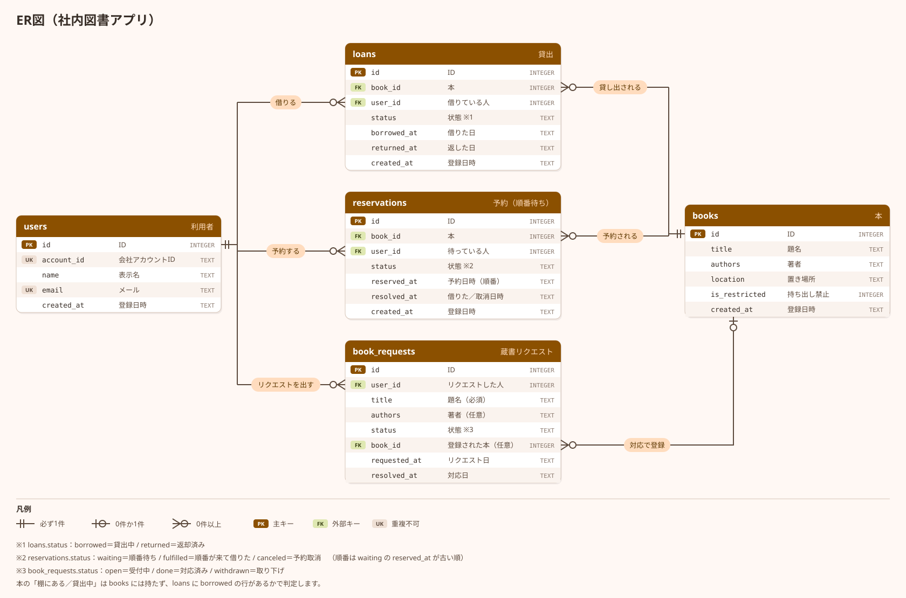
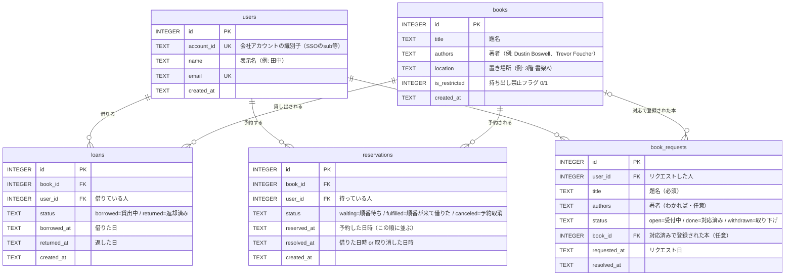

# ER図（社内図書アプリ）

`docs/UI_design.svg` の画面（ログイン／本一覧・本詳細／貸出一覧・貸出詳細／蔵書リクエスト）と、貸出中の本の予約（順番待ち）の要件から、必要なデータを洗い出したもの。



（下の Mermaid は図の元データです。テーブルを変更したら図も更新してください。）



## 画面・機能との対応

| 画面の表示・操作 | データ |
| --- | --- |
| 会社のアカウントでログイン | `users.account_id` |
| 本一覧：題名で絞り込む | `books.title` |
| 本一覧・本詳細：棚にある／貸出中 | `loans` に `status='borrowed'` の行があるかで判定（`books` には持たない） |
| 本詳細：いま借りている人 | `status='borrowed'` の `loans.user_id` → `users.name` |
| 本一覧：持ち出し禁止 | `books.is_restricted` |
| 貸出中の本を予約する（順番待ちに並ぶ） | `reservations` に `status='waiting'` で1行追加 |
| 同じ本に複数人が並ぶ | 同じ `book_id` で `waiting` の行が複数できる（同じ人の二重登録だけ禁止） |
| 自分が何番目か | 同じ本の `waiting` のうち、自分より前に並んだ人数 + 1 |
| 自分の後ろに何人いるか | 同じ本の `waiting` のうち、自分より後に並んだ人数 |
| 借りている本に順番待ちがいるか確認する | 自分の `borrowed` の `loans.book_id` について、`reservations` の `waiting` を数える |
| 貸出一覧：自分の貸出／すべて | `loans`（貸出中・返却済み）と `reservations`（`waiting`＝予約中）を合わせて表示し、`user_id` で絞り込む |
| 貸出詳細：予約中・貸出中・返却済み／借りた日・返した日 | 予約中は `reservations`、貸出中・返却済みは `loans` の `status` / `borrowed_at` / `returned_at` |
| 予約を取り消す | `reservations.status = 'canceled'` |
| 蔵書リクエスト：受付中・対応済み／取り下げる | `book_requests.status` |
| 「あなた」「田中 さん」・日付 | `book_requests.user_id` → `users.name`、`requested_at` |

### 順番待ちを調べるSQLの例

```sql
-- 自分が借りている本ごとの、待っている人数
SELECT l.book_id, COUNT(r.id) AS waiting_count
FROM loans l
LEFT JOIN reservations r
  ON r.book_id = l.book_id AND r.status = 'waiting'
WHERE l.user_id = :me AND l.status = 'borrowed'
GROUP BY l.book_id;

-- 自分の予約ごとの「何番目か」と「後ろに何人いるか」
-- 並び順は reserved_at の古い順。同じ日時なら id の小さい順（先に登録された方が先）
SELECT
  r.book_id,
  r.queue_position,
  r.total_waiting - r.queue_position AS behind_count
FROM (
  SELECT
    id, book_id, user_id,
    ROW_NUMBER() OVER (PARTITION BY book_id ORDER BY reserved_at, id) AS queue_position,
    COUNT(*)     OVER (PARTITION BY book_id)                          AS total_waiting
  FROM reservations
  WHERE status = 'waiting'
) r
WHERE r.user_id = :me;
```

順番待ちを調べるクエリが速く動くよう、`reservations(book_id, status, reserved_at)` にインデックスを張る想定です。

## 設計メモ

- **予約（順番待ち）と貸出はテーブルを分けました。** 1冊の本に「借りている人1人」と「待っている人複数」が同時に存在するためです。順番は `reserved_at` の古い順とし、順番を表す番号の列は持ちません（取消が出たときに番号を振り直さずに済むため）。
- **本の状態（棚にある／貸出中）は `loans` から算出します。** 今の `backend/src/db.ts` では `books.status` と `borrower_name` を持っていますが、貸出履歴と予約を扱うには分ける必要があります。二重管理を避けるため、`books` から状態の列は外す想定です。
- 二重登録を防ぐため、部分ユニークインデックスを張る想定です。
  - 同じ本の貸出中は1件だけ：`CREATE UNIQUE INDEX ... ON loans(book_id) WHERE status = 'borrowed'`
  - 同じ人が同じ本に二重で並ばない：`CREATE UNIQUE INDEX ... ON reservations(book_id, user_id) WHERE status = 'waiting'`
- 著者は画面上「、」区切りの1行表示で、著者による検索もないため `TEXT` 1列にしています。著者で検索する要件が出てきたら `authors` テーブルと中間テーブルに分けます。

## 確認したいこと

- **返却されたとき、本を順番待ちの先頭の人に取り置くか。** 取り置く場合は、先頭の人以外は借りられないように制御し、取り置きの期限（何日以内に借りなければ次の人へ回すか）も必要になります。そのときは `reservations` に取り置き期限の列（例：`hold_until`）を足します。
- **自分が借りている本を、自分で予約できてしまわないか。** できないようにするのが自然です（アプリ側で制御します）。
- **「持ち出し禁止」の意味。** 借りられない／社内でのみ閲覧可、のどちらかで、予約できるかどうかも変わります。
