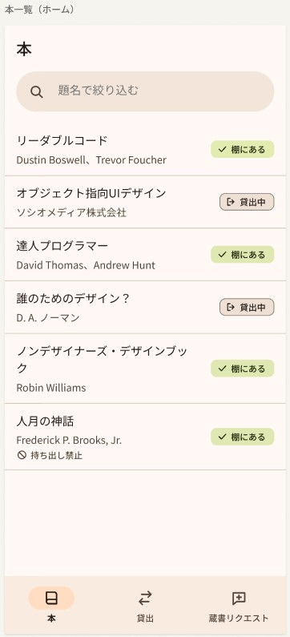

# 画面設計書：本一覧画面

社内の本を一覧で見て、借りたい本を探すための画面です。本ごとに「棚にある／貸出中／持ち出し禁止」がわかります。

| 項目           | 内容                                                                          |
| -------------- | ----------------------------------------------------------------------------- |
| 画面名         | 本一覧                                                                        |
| URL            | `/books`                                                                      |
| 画面の実装     | `frontend/src/pages/BookListPage.tsx`、`frontend/src/styles/BookListPage.css` |
| 使うAPI        | `GET /api/books`（`backend/src/index.ts`）                                    |
| もとにした資料 | `Layout_pc.jpeg`、`Layout_mobile.jpeg`（このフォルダ）、`docs/UI_design.svg`  |

## 1. 画面レイアウト

スマホ向けのレイアウトを、どの幅の画面でも使います。PCなど幅の広い画面では、幅 480px で中央に置きます（本詳細画面と同じ）。

- メニュー（高さ 80px）は画面の下に固定します。
- 画面の名前「本一覧」を左上に置きます。
- 一覧は枠で囲まず、行を区切り線で分けます。行の左に「題名と著者」、右に「状態の印」を置きます。
- 置き場所は表示しません（本詳細画面で確認します）。同じ本が何冊もあるときだけ、開いた置き場所ごとの行に表示します。
- 持ち出し禁止の本は、状態の印の位置に「棚にある」の代わりに「持ち出し禁止」の印を表示します（持ち出し禁止の本は借りられないので、いつも棚にあるため）。
- 画面の名前の下に、絞り込みの入力欄（「題名・著者で絞り込む」）を置きます。

PC向けのレイアウト案（`Layout_pc.jpeg`）は、いまは使っていません。

### レイアウト案との違い

レイアウト案の絞り込みの入力欄は「題名で絞り込む」ですが、著者でも探せるため「題名・著者で絞り込む」にしています（PBI #25）。

## 2. 画面の項目

| No. | 項目       | 種類   | 表示する内容                                      | もとのデータ              |
| --- | ---------- | ------ | ------------------------------------------------- | ------------------------- |
| 1   | メニュー   | リンク | 本／貸出／蔵書リクエスト。「本」が選択中          | －                        |
| 2   | 画面の名前 | 見出し | 「本一覧」                                        | －                        |
| 2-1 | 絞り込み   | 入力欄 | 題名・著者で絞り込むための文字                    | －                        |
| 3   | 題名       | 文字   | 本の題名。長いときは折り返す                      | `title`                   |
| 4   | 著者       | 文字   | 著者（複数のときは「、」区切りの1行）             | `authors`                 |
| 5   | 状態の印   | 印     | 「棚にある」「貸出中」「持ち出し禁止」のどれか1つ | `status`、`is_restricted` |

一覧の並びは、本を登録した順（`id` の小さい順）です。

### 状態の印の見た目

| 表示         | 条件                                               | 見た目                                                                  |
| ------------ | -------------------------------------------------- | ----------------------------------------------------------------------- |
| 棚にある     | `status` が `available`                            | チェックの印つき。背景 tertiaryContainer、枠なし                        |
| 貸出中       | `status` が `borrowed`                             | 持ち出しの印つき。背景 surfaceContainerHighest、枠 outline              |
| 持ち出し禁止 | `is_restricted` が `1` で、`status` が `available` | 禁止の印つき。背景 errorContainer、文字 onErrorContainerVariant、枠なし |

「棚にある／貸出中／持ち出し禁止」は色だけでなく、文字と印の形でも区別できるようにしています。

持ち出し禁止の本は借りられないので、いつも棚にあります。そのため「棚にある」の代わりに「持ち出し禁止」を出します。万一、持ち出し禁止の本が貸出中のデータになっていたときは、実際の状態の「貸出中」を出します。
「持ち出し禁止」の赤は、目立ちすぎないように淡い背景と濃い赤の文字にしています（真っ赤な error の色は使いません）。

## 3. 操作

| 操作                   | 動き                                                                     |
| ---------------------- | ------------------------------------------------------------------------ |
| 本の行を押す           | その本の本詳細画面（`/books/:bookId`）へ移動する。行のどこを押してもよい |
| メニューの項目を押す   | その画面へ移動する                                                       |
| 絞り込みに文字を入れる | 題名か著者に、その文字を含む本だけを表示する（下の「絞り込みの決まり」） |
| まとまりの行を押す     | 1冊ずつの行を開く・閉じる（下の「同じ本が何冊もあるとき」）              |

### 絞り込みの決まり

- 題名・著者のどちらかに、入力した文字が含まれていれば表示します（部分一致）。
- 空白は、入力した文字・題名・著者のどれでも無視します。「Dustin Boswell」は「DustinBoswell」でも「Dustin Boswell」でも見つかり、「山田太郎」は「山田 太郎」でも見つかります（半角・全角の空白とも）。
- 著者が複数のときは、区切りの「、」で分けて1人ずつ比べます。「、」は探す対象に含めないため、2人の名前をまたいだ文字（「Boswell、Trevor」など）では見つかりません。
- 英字の大文字・小文字、全角・半角（英数字・記号・カナ）は区別しません。
- 空のとき（空白だけのときも）は全ての本を表示します。
- 入力するたびにすぐ絞り込みます。API は呼び直さず、画面を開いたときに読み込んだ一覧の中から探します。
- 並びは絞り込む前と同じです。
- 処理は `frontend/src/utils/filterBooks.ts` にあります。

### 同じ本が何冊もあるとき

題名と著者がどちらも同じ本（空白・全角半角・大文字小文字だけの違いは同じとみなす）は、1行にまとめます。処理は `frontend/src/utils/groupBooks.ts` にあります。

| 表示する場所   | 内容                                                                                                                                                       |
| -------------- | ---------------------------------------------------------------------------------------------------------------------------------------------------------- |
| まとまりの行   | 代表の1冊の題名・著者。右側に代表の状態の印と、冊数・開く・閉じるの印を1つにした札（「3冊 ∨」）。札は primaryContainer の背景で、冊数は Label Large の太字 |
| 代表の1冊      | 棚にある本があれば、そのうち最初の1冊。全て貸出中なら最初の1冊。つまり印は「1冊でも棚にあれば棚にある」                                                    |
| 持ち出し禁止   | まとまりの行では、全ての本が持ち出し禁止のときだけ、状態の印の代わりに「持ち出し禁止」を出す                                                               |
| 開いたときの行 | 置き場所ごとに1行（下の「開いたときの行」）。置き場所・状態の印・持ち出し禁止。押すと本詳細画面へ移動する                                                  |

- まとまりの行を押すと開き、もう一度押すと閉じます。はじめは閉じています。
- まとまりの並びは、それぞれの最初の1冊の位置です。開いたときの行の並びは `id` の小さい順です。
- 絞り込みのあとにまとめます。冊数は、絞り込みに合った本の数です。
- 1冊だけの本は、これまでどおりの行（押すと本詳細画面へ移動）で表示します。冊数の札は出しませんが、状態の印はまとまりの行の印と縦にそろうよう、札の幅（72px）と間（8px）の分だけ左に寄せます。

#### 開いたときの行

置き場所の文字が全く同じ本は、1行にまとめます。処理は `frontend/src/utils/groupBooks.ts` の `groupByLocation` です。

| 状況                                       | 状態の印 | 状態の印の右                    | 押したときに開く本詳細画面                   |
| ------------------------------------------ | -------- | ------------------------------- | -------------------------------------------- |
| 置き場所に1冊だけ（棚にある）              | 棚にある | 「残り1冊」                     | その本                                       |
| 置き場所に1冊だけ（貸出中）                | 貸出中   | 「残り0冊」                     | その本                                       |
| 同じ置き場所に何冊もあり、棚にある本がある | 棚にある | 「残りn冊」（n は棚にある冊数） | 棚にある本のうち、最初の1冊（ID の小さい方） |
| 同じ置き場所の本が全て貸出中               | 貸出中   | 「残り0冊」                     | 最初の1冊                                    |

- 「残りn冊」はただの文字で、押しても開く・閉じるはしません（トグルを二重にしない）。行のどこを押しても本詳細画面へ移動します。
- 「持ち出し禁止」は、その置き場所の本が全て持ち出し禁止のときだけ、状態の印の代わりに出します。
- 行の並びは、それぞれの置き場所の最初の1冊の位置です。

## 4. 状況ごとの表示

| 状況                      | 表示                                                                       |
| ------------------------- | -------------------------------------------------------------------------- |
| 読み込み中                | 「読み込み中…」                                                            |
| 読み込みに失敗した        | 「本の一覧を読み込めませんでした。時間をおいて、もう一度開いてください。」 |
| 本が1冊も登録されていない | 「登録されている本はまだありません。」                                     |
| 絞り込みに合う本が無い    | 「条件に合う本は見つかりませんでした。」                                   |

どの状況でも、メニューと画面の名前は表示したままにします。

## 5. API

`GET /api/books` で、全ての本を貸出状況つきで受け取ります。画面を開いたときに1回だけ呼びます。

| 項目            | 型                       | 内容                 | この画面で使うか                 |
| --------------- | ------------------------ | -------------------- | -------------------------------- |
| `id`            | 数値                     | 本のID               | 使う（本詳細画面のURL）          |
| `title`         | 文字列                   | 題名                 | 使う                             |
| `authors`       | 文字列                   | 著者（「、」区切り） | 使う                             |
| `location`      | 文字列                   | 置き場所             | 使う（まとまりを開いたときだけ） |
| `is_restricted` | `0` / `1`                | 持ち出し禁止なら `1` | 使う                             |
| `status`        | `available` / `borrowed` | 棚にある／貸出中     | 使う                             |
| `borrower_name` | 文字列 / `null`          | 借りている人         | 使わない                         |
| `borrowed_at`   | 文字列 / `null`          | 借りた日時           | 使わない                         |
| `created_at`    | 文字列                   | 登録日時             | 使わない                         |

`status` は `books` テーブルには持たず、`loans` に貸出中の行があるかで決まります（`docs/ER_diagram.md`）。

## 6. 配色と文字

色と文字の大きさは、`docs/UI_design.svg` の末尾にある「配色と文字」の定義を使います。値は `frontend/src/styles/theme.css` に変数としてまとめてあり、画面のCSSには色コードを直接書きません。

本詳細画面（`frontend/src/BookDetail.css`）は、これとは別の色の変数を持っています。同じ名前で値が違う変数があるため（`--color-primary` など）、色をそろえるまでは互いに影響しないよう、`theme.css` の変数は共通の枠（`AppShell`）の中だけで有効にしています。

### 配色

| 使う場所                               | 役割                    | 色        |
| -------------------------------------- | ----------------------- | --------- |
| 画面の背景                             | surface                 | `#FFF8F4` |
| 題名、画面の名前                       | onSurface               | `#211A14` |
| 著者、案内の文、選択していないメニュー | onSurfaceVariant        | `#51443A` |
| メニューの背景、行にマウスを乗せたとき | surfaceContainer        | `#FAEBE0` |
| 「貸出中」の背景                       | surfaceContainerHighest | `#EFE0D5` |
| 選択中のメニューの印                   | secondaryContainer      | `#FFDCC2` |
| 「棚にある」の背景                     | tertiaryContainer       | `#DFE8B2` |
| 「棚にある」の文字                     | onTertiaryContainer     | `#181E00` |
| 「貸出中」の枠                         | outline                 | `#837469` |
| 「持ち出し禁止」の背景                 | errorContainer          | `#FFDAD6` |
| 「持ち出し禁止」の文字                 | onErrorContainerVariant | `#93000A` |
| 一覧の枠、行の区切り線                 | outlineVariant          | `#D5C3B5` |
| キーボードで選んでいる場所の枠         | primary                 | `#8B5000` |

「配色と文字」に値が載っていない色（onSurface、onSurfaceVariant、outline、outlineVariant、各 on○○Container）は、`docs/UI_design.svg` の各画面で使われている値を採りました。

### 文字（Noto Sans JP）

| 使う場所                               | 種類         | 大きさ / 行の高さ |
| -------------------------------------- | ------------ | ----------------- |
| 画面の名前                             | Title Large  | 22 / 28           |
| 題名                                   | Body Large   | 16 / 24           |
| 著者、案内の文                         | Body Medium  | 14 / 20           |
| 状態の印、持ち出し禁止、メニューの文字 | Label Medium | 12 / 16           |

Noto Sans JP は Google Fonts から読み込みます（`frontend/index.html`）。読み込めないときは、端末に入っているゴシック体で表示します。

## 7. 実装の構成

| ファイル                                          | 役割                                                           |
| ------------------------------------------------- | -------------------------------------------------------------- |
| `frontend/src/pages/BookListPage.tsx`             | 本一覧画面                                                     |
| `frontend/src/styles/BookListPage.css`            | 本一覧画面の見た目                                             |
| `frontend/src/utils/filterBooks.ts`               | 題名・著者での絞り込み                                         |
| `frontend/src/utils/groupBooks.ts`                | 同じ題名・著者の本のまとまり、置き場所ごとの行                 |
| `frontend/src/components/StatusChip.tsx` / `.css` | 状態の印（棚にある／貸出中／持ち出し禁止）。本詳細画面でも使う |
| `frontend/src/components/AppShell.tsx` / `.css`   | メニューと画面の中身を並べる共通の枠。ほかの画面でも使える     |
| `frontend/src/components/icons.tsx`               | メニューや印に使うアイコン                                     |
| `frontend/src/styles/theme.css`                   | 色と文字の変数                                                 |

共通の枠（`AppShell`）は、いまは本一覧画面だけが使っています。枠を使っていない画面の見た目は変わりません。本詳細画面は、自分の中にメニューを持っています（`frontend/src/BookDetail.tsx`）。

## 8. 決まっていないこと

- **本詳細画面と色をそろえるか。** 本一覧と本詳細で、色の変数を別々に持っています（6章）。背景や文字の色はほぼ同じですが、ボタンの色や「貸出中」の印の見た目などが少し違います。どちらかにそろえるときは、変数を `theme.css` に一本化します。
- **本詳細画面から本一覧へ戻る方法。** 本詳細画面の「戻る」ボタンとメニューは、まだ押しても動きません。いまはブラウザの「戻る」で本一覧に戻ります。
- **PC向けのレイアウトを作るか。** いまはPCでもスマホ向けのレイアウトを幅 480px で表示します。PC向けのレイアウト案（`Layout_pc.jpeg`）を使うかは、ほかの画面とあわせて決めます。
- **本一覧をホームにするか。** レイアウト案の名前は「本一覧（ホーム）」ですが、いまの `/` は開発用のリンク集のため、本一覧は `/books` のままにしています。
- **メニューの「貸出」「蔵書リクエスト」の行き先。** 画面がまだ無いため、仮に `/loans` と `/requests` へのリンクにしています。いまは押すと「ページが見つかりません」が開きます。画面ができたらURLを合わせます。
- **Noto Sans JP の読み込み方。** 社内のネットワークから Google Fonts を読み込めない場合は、文字のファイルをアプリに同梱する方法に変えます。
- **本が増えたときの表示。** いまは全件を1回で読み込んで表示します。冊数が増えて重くなったら、ページ分けを検討します。
