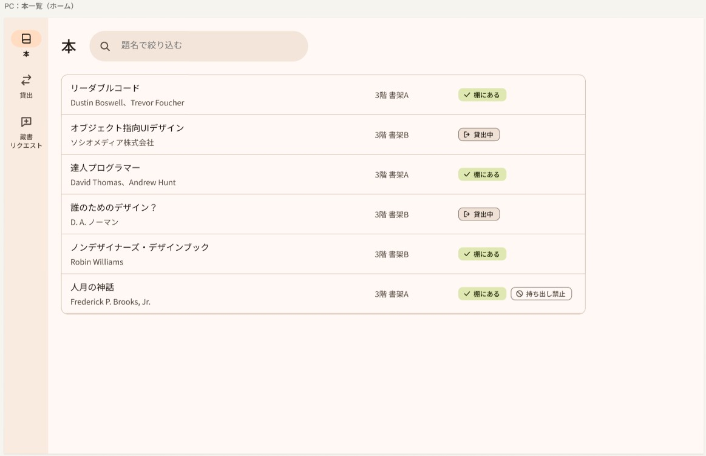

# 画面設計書：本一覧画面

社内の本を一覧で見て、借りたい本を探すための画面です。本ごとに「借りられる／貸出中／持ち出し禁止」がわかります。

| 項目           | 内容                                                                          |
| -------------- | ----------------------------------------------------------------------------- |
| 画面名         | 本一覧                                                                        |
| URL            | `/books`                                                                      |
| 画面の実装     | `frontend/src/pages/BookListPage.tsx`、`frontend/src/styles/BookListPage.css` |
| 使うAPI        | `GET /api/books`（`backend/src/index.ts`）                                    |
| もとにした資料 | `Layout_pc.jpeg`、`Layout_mobile.jpeg`（このフォルダ）、`docs/UI_design.svg`  |

## 1. 画面レイアウト

画面の幅に合わせて、レイアウトを切り替えます。区分と、どの画面にも共通の決まり（メニュー・余白・区切り線・幅など）は [レスポンシブデザインの決まり](../../Responsive_design.md) を参照してください。ここでは、本一覧画面での見え方を書きます。

| 画面の幅                  | レイアウト                                                                                                                                                          | もとにした資料       |
| ------------------------- | ------------------------------------------------------------------------------------------------------------------------------------------------------------------- | -------------------- |
| 〜599px（スマホ）         | メニューは画面の下。一覧は枠で囲まず、行を区切り線で分ける。行の左に「題名と著者」（1冊だけの本は、その下に置き場所）、右に「状態の印」（何冊もある本は冊数の札も） | `Layout_mobile.jpeg` |
| 600px〜（タブレット・PC） | メニューは画面の左。一覧を角の丸い枠で囲む（幅は最大 720px）。行の中の並びはスマホと同じ                                                                            | `Layout_pc.jpeg`     |

- 画面の名前の下に、絞り込みの入力欄（「題名・著者で絞り込む」）を置きます。入力欄の幅は、一覧の枠の幅にそろえます。場所・ステータスの選択肢は、〜599px（スマホ）では入力欄の右端のボタン（漏斗の印）で開くモーダルに、600px〜では入力欄のすぐ下に直接並べます。
- 絞り込みの入力欄は、下にスクロールしても画面の上の端に残します（画面の名前は流れて見えなくなります）。一覧の下の方からでも、上に戻らずに探し直せます。どの幅でも同じです。
  - 600px〜で入力欄の下に並べた場所・ステータスの選択肢も、入力欄と一緒に残します。一覧の下の方からでも、条件を変えられます。〜599px では、入力欄の右端のボタンが一緒に残ります。
  - 入力欄の帯は画面と同じ背景で塗り、下を流れる一覧が透けないようにします。貼り付いても色は変えません。
  - キーボードで行を選んでいったとき、選んだ行が入力欄（と選択肢）の下に隠れないようにします。置き場所が増えて選択肢が折り返し、帯が高くなっても同じです。
- 同じ本が何冊もあるときは1行にまとめ、開いた行（置き場所ごとの行）に置き場所を表示します。
- どの幅でも、画面の名前「本一覧」を左上に置きます。
- どの幅でも、行と行の間に区切り線を引きます（枠で囲むときは枠の内側）。
- 持ち出し禁止の本は、状態の印の位置に「借りられる」の代わりに「持ち出し禁止」の印を表示します（持ち出し禁止の本は借りられないので、いつも棚にあるため）。
- PC向けのレイアウト案と違い、一覧は表の形にせず、置き場所の列も作りません。同じ本が何冊もあるときは1行にまとめるため、置き場所は、1冊だけの本は著者の下に、何冊もある本は開いた行に出します。一覧の幅は 960px ではなく 720px までにしています（題名と状態の印が離れて見えないようにするため）。

### レイアウト案との違い

レイアウト案の絞り込みの入力欄は「題名で絞り込む」ですが、著者でも探せるため「題名・著者で絞り込む」にしています（PBI #25）。

## 2. 画面の項目

| No. | 項目       | 種類   | 表示する内容                                                                                                                  | もとのデータ                          |
| --- | ---------- | ------ | ----------------------------------------------------------------------------------------------------------------------------- | ------------------------------------- |
| 1   | メニュー   | リンク | 本一覧／借りている本／蔵書リクエスト。「本一覧」が選択中                                                                      | －                                    |
| 2   | 画面の名前 | 見出し | 「本一覧」                                                                                                                    | －                                    |
| 2-1 | 絞り込み   | 入力欄 | 題名・著者で絞り込むための文字                                                                                                | －                                    |
| 2-2 | 条件ボタン | ボタン | 〜599px だけ。入力欄の右端。押すと場所・ステータスの条件のモーダルを開く。条件を選んでいるときは色を付け、選んでいる数を出す  | －                                    |
| 2-3 | 条件の欄   | 選択肢 | 600px〜 だけ。入力欄の下に「場所：☐…」「ステータス：○…」と「すべて解除」                                                      | `location`、`status`、`is_restricted` |
| 3   | 題名       | 文字   | 本の題名。長いときは折り返す                                                                                                  | `title`                               |
| 3-1 | 置き場所   | 文字   | 1冊だけの本の置き場所。著者の下に「置き場所：…」と出す（どの幅でも）。折り返すときは、最後の行が1文字だけにならないようにする | `location`                            |
| 4   | 著者       | 文字   | 著者（複数のときは「、」区切りの1行）                                                                                         | `authors`                             |
| 5   | 状態の印   | 印     | 「借りられる」「貸出中」「持ち出し禁止」のどれか1つ                                                                           | `status`、`is_restricted`             |

一覧の並びは、本を登録した順（`id` の小さい順）です。

### 状態の印の見た目

| 表示         | 条件                                               | 見た目                                                                  |
| ------------ | -------------------------------------------------- | ----------------------------------------------------------------------- |
| 借りられる   | `status` が `available`（持ち出し禁止でない）      | チェックの印つき。背景 successContainer（独自に足す緑）、枠なし         |
| 誰かが借用中 | `status` が `borrowed`                             | バツの印つき。背景 surfaceVariant（灰）、枠なし                         |
| 持ち出し禁止 | `is_restricted` が `1` で、`status` が `available` | 禁止の印つき。背景 errorContainer、文字 onErrorContainerVariant、枠なし |

3つの印は、いちばん長い「持ち出し禁止」に合わせて同じ大きさにしています。枠はボタンと間違われるので付けません。
「借りられる／誰かが借用中／持ち出し禁止」は色だけでなく、文字と印の形でも区別できるようにしています。
「持ち出し禁止」の赤は、目立ちすぎないように淡い背景と濃い赤の文字にしています（真っ赤な error の色は使いません）。

持ち出し禁止の本は借りられないので、いつも棚にあります。そのため「借りられる」の代わりに「持ち出し禁止」を出します。万一、持ち出し禁止の本が借りられているデータになっていたときは、実際の状態の「誰かが借用中」を出します。

状態の色は、画面をまたいで次の決まりでそろえています（貸出一覧・貸出詳細の印も同じ）。

| 状態               | 色                                                                                  |
| ------------------ | ----------------------------------------------------------------------------------- |
| 借りられる         | 緑（独自に足す成功色）                                                              |
| あなたが借りている | primary の系統（淡い primary-container。濃い primary はボタンに見えるため使わない） |
| 誰かが借りている   | 灰色系（surface-variant）                                                           |
| 持ち出し禁止       | 淡い赤（error-container）＋禁止のアイコン                                           |
| 返却済み           | 灰色系（outline、文字も薄め）                                                       |
| （将来）延滞       | error（赤）                                                                         |

## 3. 操作

| 操作                   | 動き                                                                           |
| ---------------------- | ------------------------------------------------------------------------------ |
| 本の行を押す           | その本の本詳細画面（`/books/:bookId`）へ移動する。行のどこを押してもよい       |
| メニューの項目を押す   | その画面へ移動する                                                             |
| 絞り込みに文字を入れる | 題名か著者に、その文字を含む本だけを表示する（下の「絞り込みの決まり」）       |
| まとまりの行を押す     | 1冊ずつの行を開く・閉じる（下の「同じ本が何冊もあるとき」）                    |
| 条件ボタンを押す       | 場所・ステータスの条件のモーダルを開く（下の「場所・ステータスでの絞り込み」） |
| 場所・ステータスを選ぶ | 選んだ条件に合う本だけを表示する（下の「場所・ステータスでの絞り込み」）       |

### 状態の保持

本詳細画面などへ移動してから本一覧画面へ戻ってきたとき、離れる前の見え方のまま続きを見られるようにします。

| 残すもの               | 戻ってきたときの表示                                       |
| ---------------------- | ---------------------------------------------------------- |
| 絞り込みに入れた文字   | 入力欄に同じ文字が入り、その文字で絞り込んだ一覧を表示する |
| 開いていたまとまり     | 開いたまま表示する                                         |
| 場所・ステータスの条件 | 同じ条件を選んだまま、その条件で絞り込んだ一覧を表示する   |
| 縦のスクロール位置     | 一覧を読み込み終えたあと、離れる前の位置へ戻す             |

- ←ボタン・ブラウザの「戻る」・メニューの「本一覧」のどれで戻っても残ります。
- 残すのはアプリの中を移動しているあいだだけです。ブラウザで読み込み直したり、タブを閉じたりすると、初めの状態（入力欄は空、まとまりは閉じる、いちばん上）に戻ります。
- 一覧（`GET /api/books`）は、戻ってくるたびに読み込み直します（貸出の状況を新しくするため）。読み込み中は画面が短いので、スクロール位置は覚え直しません。
- 状態は `frontend/src/state/bookListState.ts`（状態の形と変え方）と `frontend/src/state/BookListStateProvider.tsx`（状態を持つ Provider。`App.tsx` でルートより上に置く）、`frontend/src/state/BookListStateContext.ts`（状態を使う hook `useBookListState`）にあります。場所・ステータスの条件も `BookListState`（`locations`・`status`）に入れているので、同じように画面を移動しても残ります。

### 絞り込みの決まり

- 題名・著者のどちらかに、入力した文字が含まれていれば表示します（部分一致）。
- 空白は、入力した文字・題名・著者のどれでも無視します。「Dustin Boswell」は「DustinBoswell」でも「Dustin Boswell」でも見つかり、「山田太郎」は「山田 太郎」でも見つかります（半角・全角の空白とも）。
- 著者が複数のときは、区切りの「、」で分けて1人ずつ比べます。「、」は探す対象に含めないため、2人の名前をまたいだ文字（「Boswell、Trevor」など）では見つかりません。
- 英字の大文字・小文字、全角・半角（英数字・記号・カナ）は区別しません。
- 空のとき（空白だけのときも）は全ての本を表示します。
- 入力するたびにすぐ絞り込みます。API は呼び直さず、画面を開いたときに読み込んだ一覧の中から探します。
- 並びは絞り込む前と同じです。
- 処理は `frontend/src/utils/filterBooks.ts` にあります。

### 場所・ステータスでの絞り込み

| 項目       | 選択肢                                                                                                          | 選び方                         |
| ---------- | --------------------------------------------------------------------------------------------------------------- | ------------------------------ |
| 場所       | DB の本にある置き場所の全て。本の一覧（`GET /api/books`）の置き場所を重複なしで、名前（文字コード）の順に並べる | チェックボックス（いくつでも） |
| ステータス | すべて／借りられる。はじめは「すべて」                                                                          | ラジオボタン（1つだけ）        |

画面の幅で、選ぶ場所を変えます（区分は [レスポンシブデザインの決まり](../../Responsive_design.md)）。

| 画面の幅          | 選ぶ場所                                                                                                                                                                                              |
| ----------------- | ----------------------------------------------------------------------------------------------------------------------------------------------------------------------------------------------------- |
| 〜599px（スマホ） | 入力欄の右端の条件ボタンで開くモーダル（`frontend/src/components/BookFilterDialog.tsx`）。選択肢は1行に1つ。「すべて解除」「閉じる」。Esc キー・モーダルの外を押しても閉じる                          |
| 600px〜           | 入力欄のすぐ下に直接並べる（「場所：☐ 新川 3F 共用 ☐ 横浜 13F 共用 …」「ステータス：○ すべて ○ 借りられる」）。入りきらないときは折り返す。ステータスの行の右端に「すべて解除」。条件ボタンは出さない |

- 選んだ時点で一覧に反映します。モーダルと直接並べた欄は同じ条件を表示します（画面の幅を変えても、選んだ条件はそのまま）。モーダルを開いたまま 600px 以上に広げると、モーダルは閉じます。
- 「すべて解除」で場所のチェックを全て外し、ステータスを「すべて」に戻します（入力欄の文字はそのまま）。条件を選んでいないときは押せません。
- 場所を複数選んだときは、どれかに合えば表示します（「または」）。場所とステータスの両方を選んだときは、両方に合う本を表示します（「かつ」）。場所を選んでいない・ステータスが「すべて」のときは、その項目では絞り込みません。
- 入力欄に文字を入れているときは、条件に合い、かつ題名・著者にその文字を含む本を表示します。
- 「借りられる」は、状態の印が「借りられる」になる冊（貸出中でなく、持ち出し禁止でもない冊）です。絞り込みで「誰かが借用中」「持ち出し禁止」は選べません（使う機会が少ないため）。一覧には条件に合う冊だけを出します。同じ本・同じ置き場所に何冊もあっても、借りられない冊は出しません（例：「借りられる」で絞ると、借りられる冊だけでまとめ、まとまりの冊数・状態の印・押したときに開く本も、借りられる冊で決めます）。合う冊が1冊だけになったときは、1冊の行（置き場所つき）で出します。
- 開いた行の「残りn冊／m冊」も、条件に合う冊だけで数えます。例：横浜 14F SD部 に借りられる1冊・持ち出し禁止1冊・借用中1冊があるとき、「借りられる」で絞ると、行は「借りられる・残り1冊／1冊」になります（持ち出し禁止・借用中の冊は数えない）。絞り込んでいるときは、本詳細画面の「棚にある冊数」と違うことがあります。
- 本の一覧を読み込み中・読み込めなかったときは、置き場所が分からないので、条件ボタンは押せず、直接並べる欄も出しません。選んでいた場所が一覧から無くなったときも、外せるように選択肢に残します。
- 処理は `frontend/src/utils/filterByConditions.ts`（条件に合うか・置き場所の一覧）と `frontend/src/utils/filterBookList.ts`（一覧に出す本）、選択肢の部品は `frontend/src/components/BookFilterFields.tsx` にあります。

### 同じ本が何冊もあるとき

題名と著者がどちらも同じ本（空白・全角半角・大文字小文字だけの違いは同じとみなす）は、1行にまとめます。処理は `frontend/src/utils/groupBooks.ts` にあります。

| 表示する場所   | 内容                                                                                                                                                         |
| -------------- | ------------------------------------------------------------------------------------------------------------------------------------------------------------ |
| まとまりの行   | 代表の1冊の題名・著者。右側に代表の状態の印と、冊数・開く・閉じるの印を1つにした札（「全3冊 ∨」）。札は primaryContainer の背景で、冊数は Label Large の太字 |
| 代表の1冊      | 棚にある本があれば、そのうち最初の1冊。全て貸出中なら最初の1冊。つまり印は「1冊でも借りられる本があれば借りられる」                                          |
| 持ち出し禁止   | まとまりの行では、全ての本が持ち出し禁止のときだけ、状態の印の代わりに「持ち出し禁止」を出す                                                                 |
| 開いたときの行 | 置き場所ごとに1行（下の「開いたときの行」）。置き場所・状態の印・持ち出し禁止。押すと本詳細画面へ移動する                                                    |

- まとまりの行を押すと開き、もう一度押すと閉じます。はじめは閉じています。
- まとまりの並びは、それぞれの最初の1冊の位置です。開いたときの行の並びは `id` の小さい順です。
- 絞り込みのあとにまとめます。札の「全n冊」と開いた行の「／m冊」は、絞り込みに合った冊の数です。開いた行の m を足すと、札の冊数になります。開いた行の「残りn冊」も、絞り込みに合った冊で数えます（上の「場所・ステータスでの絞り込み」）。
- 1冊だけの本は、これまでどおりの行（押すと本詳細画面へ移動）で表示します。冊数の札は出しませんが、状態の印はまとまりの行の印と縦にそろうよう、札の幅（72px）と間（8px）の分だけ左に寄せます。

#### 開いたときの行

置き場所の文字が全く同じ本は、1行にまとめます。処理は `frontend/src/utils/groupBooks.ts` の `groupByLocation` です。

| 状況                                       | 状態の印   | 状態の印の右                                                                                                                     | 押したときに開く本詳細画面                   |
| ------------------------------------------ | ---------- | -------------------------------------------------------------------------------------------------------------------------------- | -------------------------------------------- |
| 置き場所に1冊だけ（棚にある）              | 借りられる | 「残り1冊／1冊」                                                                                                                 | その本                                       |
| 置き場所に1冊だけ（貸出中）                | 貸出中     | 「残り0冊／1冊」                                                                                                                 | その本                                       |
| 同じ置き場所に何冊もあり、棚にある本がある | 借りられる | 「残りn冊／m冊」（n は棚にある冊数、m はその置き場所の冊数。貸出中の冊も数える。絞り込んでいるときは、どちらも条件に合う冊だけ） | 棚にある本のうち、最初の1冊（ID の小さい方） |
| 同じ置き場所の本が全て貸出中               | 貸出中     | 「残り0冊／m冊」                                                                                                                 | 最初の1冊                                    |

- 「／m冊」は「残りn冊」より目立たない色・太さで出します。借りられている冊があることが分かり、置き場所ごとの m を足すと、札の冊数になります。
- 「残りn冊／m冊」はただの文字で、押しても開く・閉じるはしません（トグルを二重にしない）。行のどこを押しても本詳細画面へ移動します。
- 「持ち出し禁止」は、その置き場所の本が全て持ち出し禁止のときだけ、状態の印の代わりに出します。
- 行の並びは、それぞれの置き場所の最初の1冊の位置です。

## 4. 状況ごとの表示

| 状況                      | 表示                                                                       |
| ------------------------- | -------------------------------------------------------------------------- |
| 読み込み中                | 「読み込み中…」                                                            |
| 読み込みに失敗した        | 「本の一覧を読み込めませんでした。時間をおいて、もう一度開いてください。」 |
| 本が1冊も登録されていない | 「登録されている本はまだありません。」                                     |
| 絞り込みに合う本が無い    | 「条件に合う本は見つかりませんでした。」                                   |

どの状況でも、メニューと画面の名前は表示したままにします。

## 5. API

`GET /api/books` で、全ての本を貸出状況つきで受け取ります。画面を開いたときに1回だけ呼びます。

| 項目            | 型                       | 内容                 | この画面で使うか                                    |
| --------------- | ------------------------ | -------------------- | --------------------------------------------------- |
| `id`            | 数値                     | 本のID               | 使う（本詳細画面のURL）                             |
| `title`         | 文字列                   | 題名                 | 使う                                                |
| `authors`       | 文字列                   | 著者（「、」区切り） | 使う                                                |
| `location`      | 文字列                   | 置き場所             | 使う（1冊だけの本の行と、まとまりを開いたときの行） |
| `is_restricted` | `0` / `1`                | 持ち出し禁止なら `1` | 使う                                                |
| `status`        | `available` / `borrowed` | 借りられる／貸出中   | 使う                                                |
| `borrower_name` | 文字列 / `null`          | 借りている人         | 使わない                                            |
| `borrowed_at`   | 文字列 / `null`          | 借りた日時           | 使わない                                            |
| `created_at`    | 文字列                   | 登録日時             | 使わない                                            |

`status` は `books` テーブルには持たず、`loans` に貸出中の行があるかで決まります（`docs/ER_diagram.md`）。

## 6. 配色と文字

色と文字の大きさは、`docs/UI_design.svg` の末尾にある「配色と文字」の定義を使います。値は `frontend/src/styles/theme.css` に変数としてまとめてあり、画面のCSSには色コードを直接書きません。

本詳細画面（`frontend/src/BookDetail.css`）は、これとは別の色の変数を持っています。同じ名前で値が違う変数があるため（`--color-primary` など）、色をそろえるまでは互いに影響しないよう、`theme.css` の変数は共通の枠（`AppShell`）の中だけで有効にしています。

### 配色

| 使う場所                               | 役割                    | 色        |
| -------------------------------------- | ----------------------- | --------- |
| 画面の背景                             | surface                 | `#FFF8F4` |
| 題名、画面の名前                       | onSurface               | `#211A14` |
| 著者、案内の文、選択していないメニュー | onSurfaceVariant        | `#51443A` |
| メニューの背景、行にマウスを乗せたとき | surfaceContainer        | `#FAEBE0` |
| 「貸出中」の背景                       | surfaceContainerHighest | `#EFE0D5` |
| 選択中のメニューの印                   | secondaryContainer      | `#FFDCC2` |
| 「借りられる」の背景                   | tertiaryContainer       | `#DFE8B2` |
| 「借りられる」の文字                   | onTertiaryContainer     | `#181E00` |
| 「貸出中」の枠                         | outline                 | `#837469` |
| 「持ち出し禁止」の背景                 | errorContainer          | `#FFDAD6` |
| 「持ち出し禁止」の文字                 | onErrorContainerVariant | `#93000A` |
| 一覧の枠、行の区切り線                 | outlineVariant          | `#D5C3B5` |
| キーボードで選んでいる場所の枠         | primary                 | `#8B5000` |

「配色と文字」に値が載っていない色（onSurface、onSurfaceVariant、outline、outlineVariant、各 on○○Container）は、`docs/UI_design.svg` の各画面で使われている値を採りました。

### 文字（Noto Sans JP）

| 使う場所                               | 種類         | 大きさ / 行の高さ |
| -------------------------------------- | ------------ | ----------------- |
| 画面の名前                             | Title Large  | 22 / 28           |
| 題名                                   | Body Large   | 16 / 24           |
| 著者、案内の文                         | Body Medium  | 14 / 20           |
| 状態の印、持ち出し禁止、メニューの文字 | Label Medium | 12 / 16           |

Noto Sans JP は Google Fonts から読み込みます（`frontend/index.html`）。読み込めないときは、端末に入っているゴシック体で表示します。

## 7. 実装の構成

| ファイル                                              | 役割                                                                 |
| ----------------------------------------------------- | -------------------------------------------------------------------- |
| `frontend/src/pages/BookListPage.tsx`                 | 本一覧画面                                                           |
| `frontend/src/styles/BookListPage.css`                | 本一覧画面の見た目                                                   |
| `frontend/src/utils/filterBooks.ts`                   | 題名・著者での絞り込み                                               |
| `frontend/src/utils/groupBooks.ts`                    | 同じ題名・著者の本のまとまり、置き場所ごとの行                       |
| `frontend/src/state/bookListState.ts`                 | 画面を離れても残す状態（絞り込みの文字・開いたまとまり）の形と変え方 |
| `frontend/src/state/BookListStateProvider.tsx`        | 本一覧画面の状態とスクロール位置を持つ Provider                      |
| `frontend/src/state/BookListStateContext.ts`          | 本一覧画面の状態を使う hook（`useBookListState`）                    |
| `frontend/src/components/StatusChip.tsx` / `.css`     | 状態の印（借りられる／貸出中／持ち出し禁止）。本詳細画面でも使う     |
| `frontend/src/components/AppShell.tsx` / `.css`       | メニューと画面の中身を並べる共通の枠。全画面で使う                   |
| `frontend/src/components/NavigationBar.tsx` / `.css`  | 画面の下のメニュー（幅 599px まで）                                  |
| `frontend/src/components/NavigationRail.tsx` / `.css` | 画面の左のメニュー（幅 600px から）                                  |
| `frontend/src/components/navItems.tsx`                | メニューの項目（2 つのメニューで共通）                               |
| `frontend/src/components/icons.tsx`                   | メニューや印に使うアイコン                                           |
| `frontend/src/styles/theme.css`                       | 色と文字の変数                                                       |

共通の枠（`AppShell`）は、全画面で使っています（`frontend/src/App.tsx`）。画面の幅による切り替えの決まりは `docs/Responsive_design.md` にまとめています。

## 8. 決まっていないこと

- **本詳細画面と色をそろえるか。** 本一覧と本詳細で、色の変数を別々に持っています（6章）。背景や文字の色はほぼ同じですが、ボタンの色や「貸出中」の印の見た目などが少し違います。どちらかにそろえるときは、変数を `theme.css` に一本化します。
- **本一覧をホームにするか。** レイアウト案の名前は「本一覧（ホーム）」ですが、いまの `/` は開発用のリンク集のため、本一覧は `/books` のままにしています。
- **メニューの「蔵書リクエスト」の行き先。** 画面がまだ無いため、仮に `/requests` へのリンクにしています。いまは押すと「ページが見つかりません」が開きます。画面ができたらURLを合わせます。
- **Noto Sans JP の読み込み方。** 社内のネットワークから Google Fonts を読み込めない場合は、文字のファイルをアプリに同梱する方法に変えます。
- **本が増えたときの表示。** いまは全件を1回で読み込んで表示します。冊数が増えて重くなったら、ページ分けを検討します。
